# easyCMDB

easyCMDB is a configuration inventory you can enter from an application, a landscape, an environment, or a cloud resource and follow through to everything related.

The connections are carried by the resources themselves. A landscape appears on an application because a resource for that application lives there. Follow a teal name and you land on the other record. An external-link icon leaves easyCMDB for a repository, a runbook, a production site, or a cloud console.

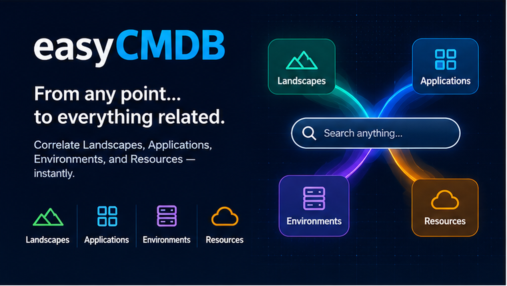

Anyone signed in can browse **Discover**. An application editor also gets **Management → Applications**. An admin gets the rest of Management: landscapes, environments, resources, and hosting providers. Deactivate hides a row. **Show inactive** brings it back.

The API is [easycmdb-api](https://github.com/karlamber/easycmdb-api). The product name is easyCMDB. The technical alias in the API, Postgres schema, and Cognito claim prefixes remains `argus`.

## Screens

Captures live in [`docs/screenshots`](docs/screenshots).

### Sign-in

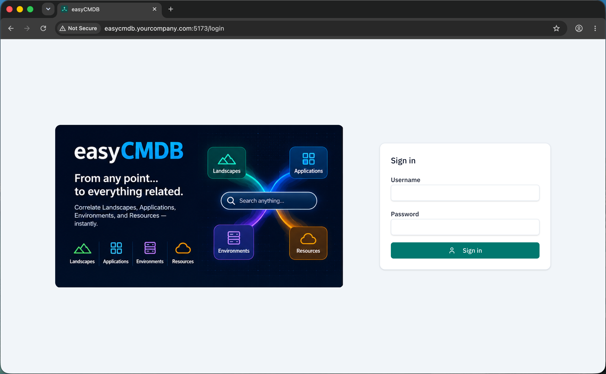

Sign-in is the front door. The panel is the product in one picture: start from landscapes, applications, environments, or resources. Username and password are the local demo. When Cognito is configured, the same page offers the hosted sign-in. After you sign in, easyCMDB returns you to the page you were opening, or to the applications list.

### Discover

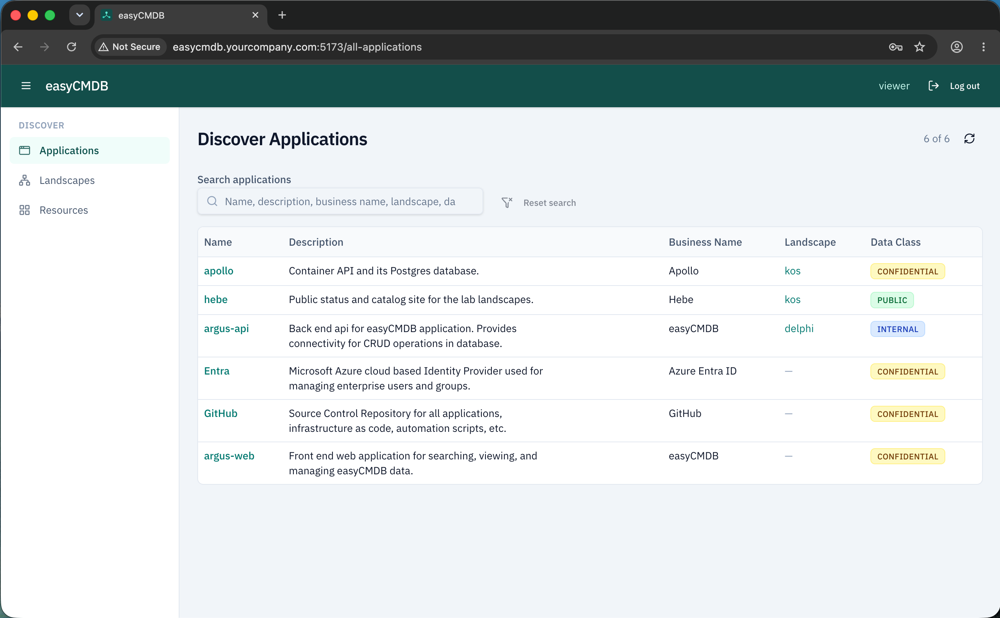

The application name opens that application. The landscape column is computed: it lists every landscape where this application has a resource, and each name opens that landscape. An application with no resources shows a dash, so a shared service such as an identity provider can live in the inventory without a deployment. Search matches the alias, description, business name, landscape, and data class. A long description clips to two lines; hover shows the rest.

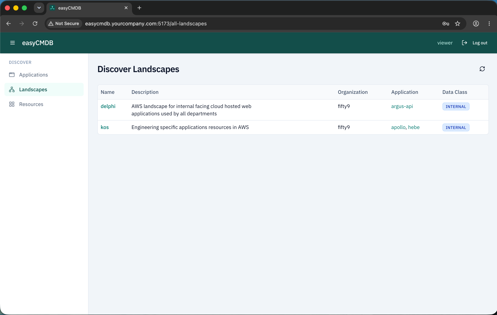

The landscape name opens that landscape. The application column is the same relationship read the other way: every application that has a resource here, and each alias opens that application. The data class is the landscape's own classification.

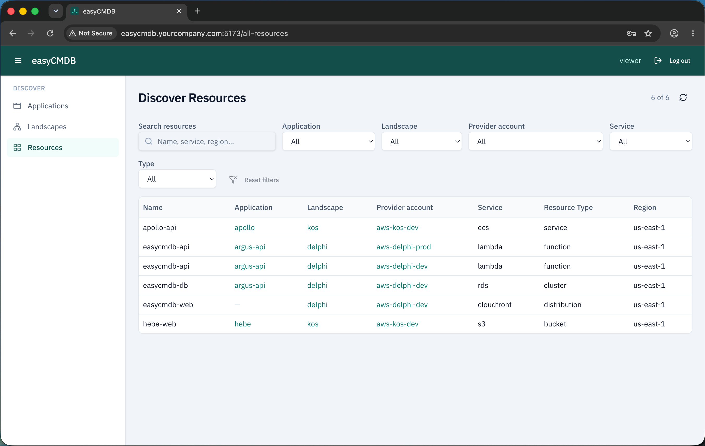

The dropdowns narrow the inventory, and search runs inside that set. Application, landscape, and provider account each open the matching page. A blank application means the resource is environment-scoped: it belongs to the account, such as a shared distribution, rather than to one application. The resource name stays on this list. Open the provider account to see it beside the other resources in that account.

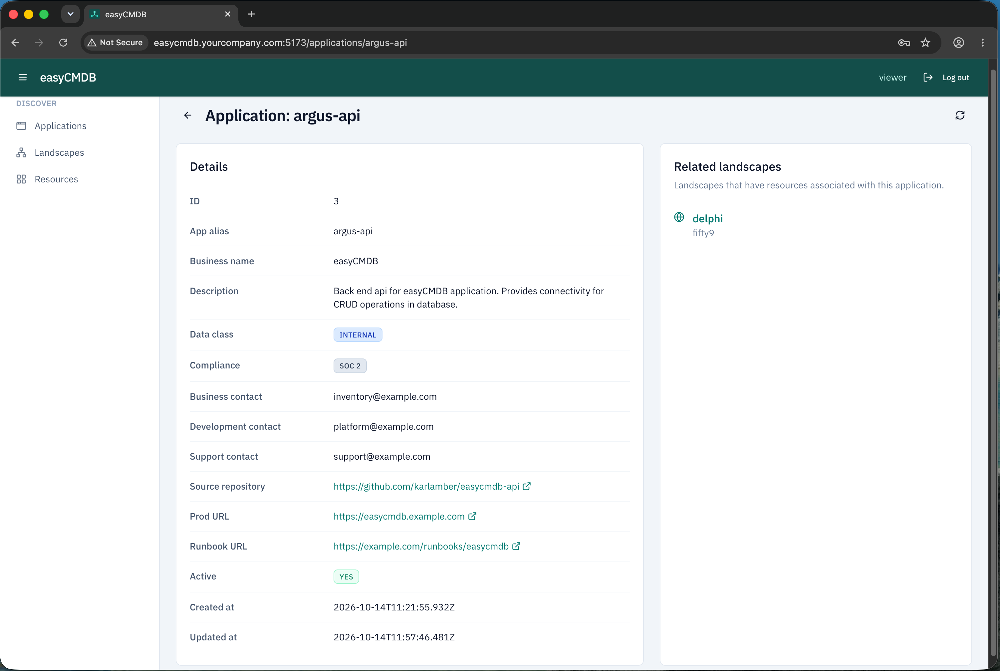

Source repository, production URL, and runbook open outside easyCMDB. Compliance tags stack on the single data class, so a record can be both internal and in scope for SOC 2. Related landscapes are the landscapes that hold a resource for this application. Each name opens that landscape.

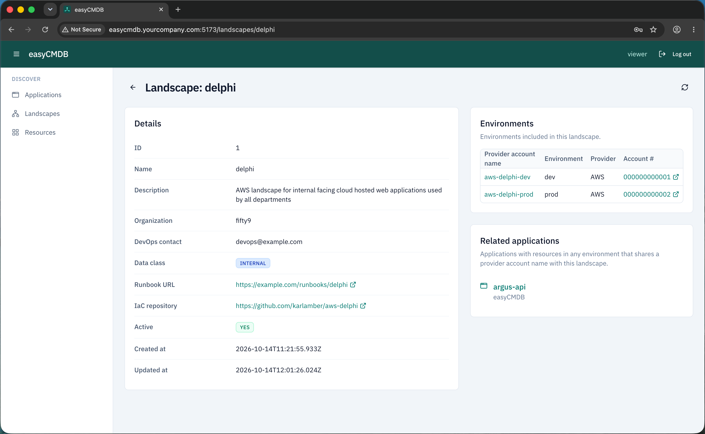

Runbook and IaC repository open outside easyCMDB. In the environments table, the account name opens the provider-account page. The account number opens that environment's direct link, usually the cloud console, when one is saved. Related applications reach past this landscape: an application is listed when it has a resource in any environment that shares a provider account name with this landscape. An account used by two landscapes still shows the applications on it.

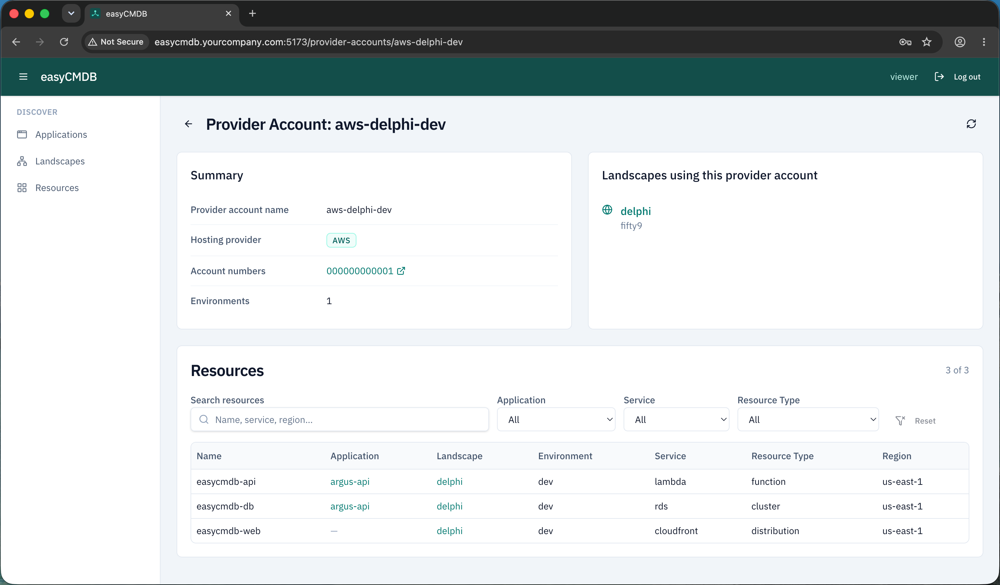

This page gathers every environment that uses the same account name. The account number opens the direct link in a new tab. Each landscape name opens that landscape. In the resource table, the application and landscape names open those pages, and the filters apply to this account only.

### Management

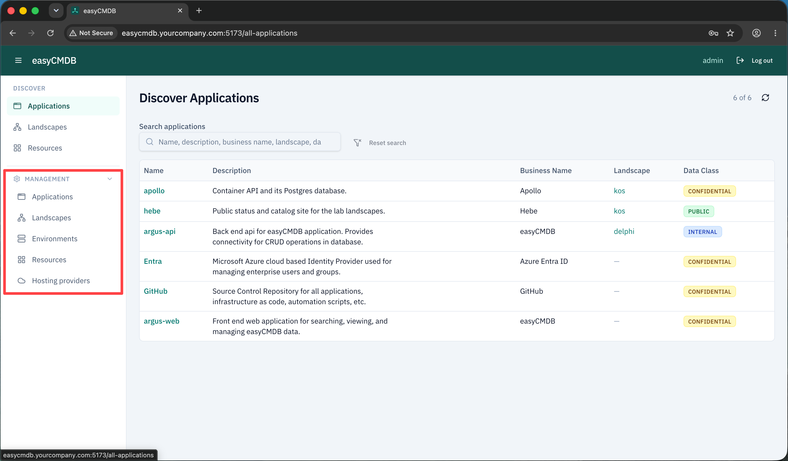

A viewer sees Discover only. An application editor also sees Management → Applications. An admin sees landscapes, environments, resources, and hosting providers. The easyCMDB wordmark returns to the applications list.

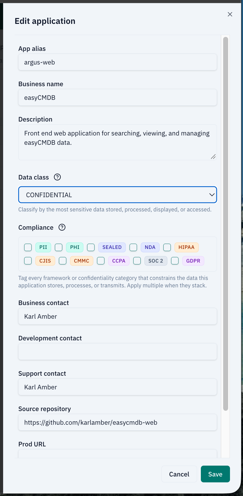

Data class is one sensitivity level, from public to restricted. The help text says to classify by the most sensitive data the application stores, processes, displays, or accesses. Compliance is a set of tags you combine — privacy, confidentiality agreements, and regulatory frameworks — and each tag explains when it applies. Repository, production URL, and runbook are the links Discover opens.

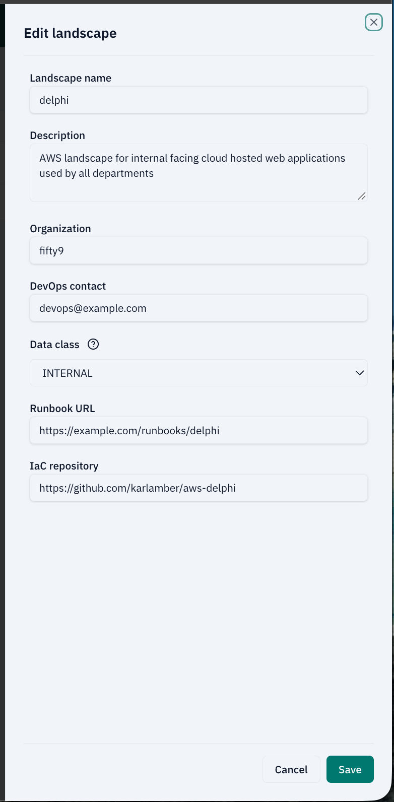

Organization, DevOps contact, data class, runbook, and IaC repository are the fields behind the landscape page. The runbook and repository are the external links on that page.

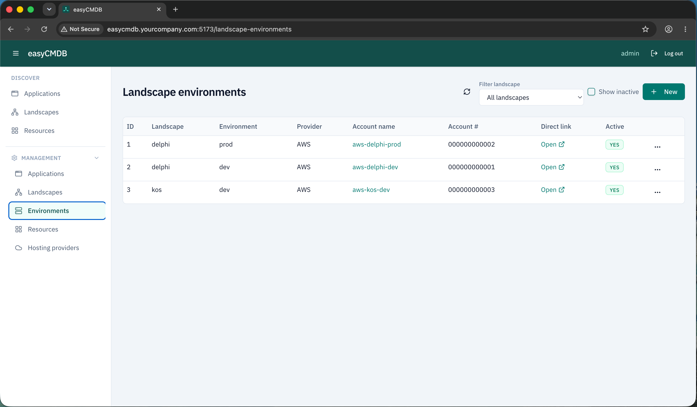

This is the list of every environment across landscapes. Filter it down to one landscape. The account name opens the provider-account page, so you can see what that account contains and come back. **Open** on Direct link goes to the console URL. **Show inactive** reveals deactivated environments. The row menu edits or deactivates. Deactivate hides the row until Show inactive is on. Every management list works this way.

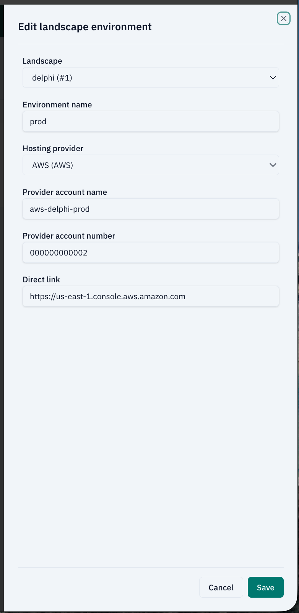

The direct link is the URL the account number and the Open action use. The provider account name is what groups environments onto one provider-account page. Two environments that share that name are one account in Discover.

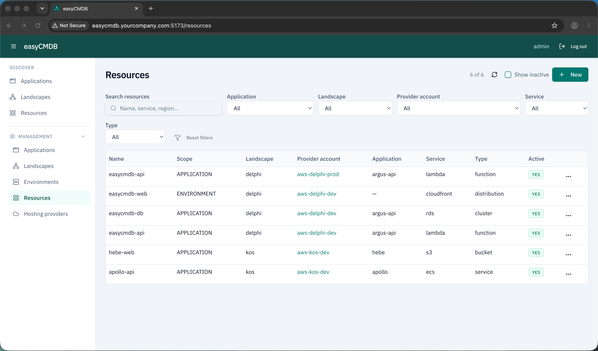

Scope is the distinction Discover only implies. **Application** belongs to one application. **Environment** belongs to the account and shows no application. The provider account name opens the provider-account page. Filters narrow the working set. Show inactive and Deactivate match the environments list.

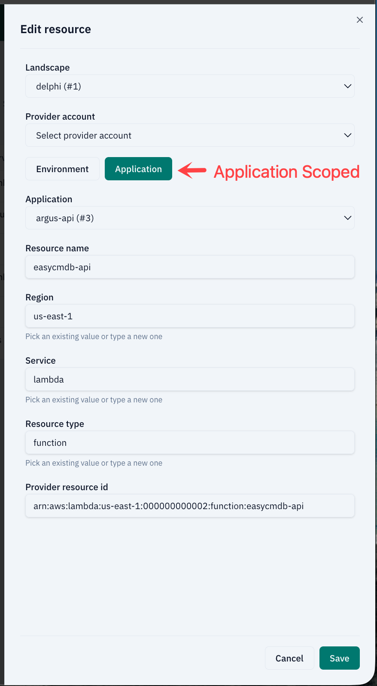

Application scope requires an application. The provider account list is the environments of the landscape you picked. Region, service, and resource type suggest values already in the inventory and still accept a new one, so the filters on Discover stay consistent without a separate catalog. Provider resource id holds the cloud identifier, such as an ARN. While creating, **Save + New** keeps the form open for the next resource.

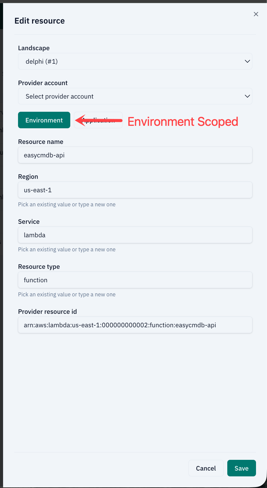

Environment scope drops the application. Use it for something the account owns and several applications share. Switching back to Application asks for an application again.

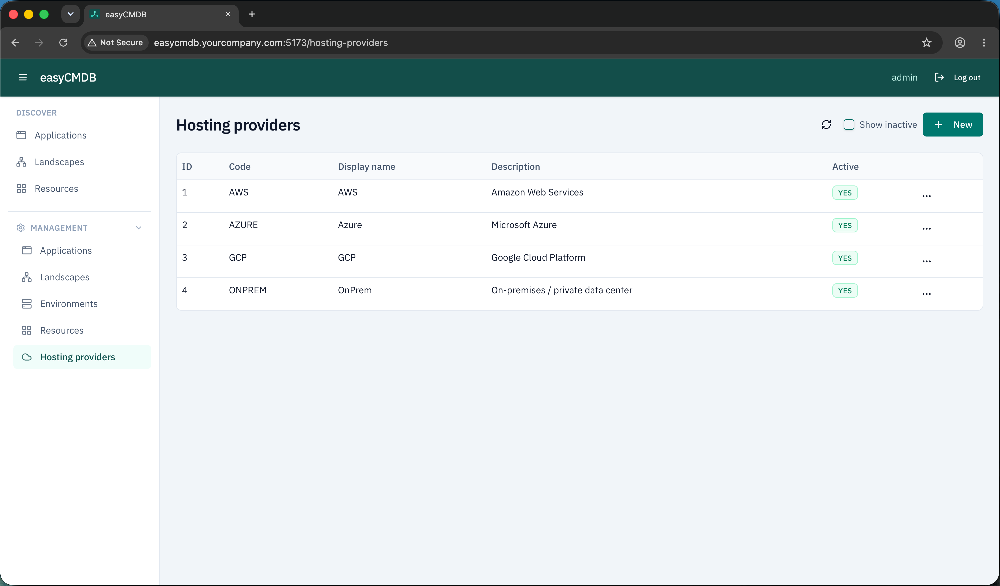

This is the short list the environment form offers: a code, a display name, and a description for each cloud or for on-premises. Environments store the code. Deactivate hides a provider from new environments until Show inactive is on.

## Stack

| Layer        | Choice                                                |
| ------------ | ----------------------------------------------------- |
| UI           | React 19, function components and hooks               |
| Build        | Vite 6, `/api` dev proxy                              |
| Styling      | Tailwind CSS v4, IBM Plex Sans, teal and slate tokens |
| Components   | shadcn/ui (Radix primitives in `src/components/ui/`)  |
| Routing      | React Router v7                                       |
| Server state | TanStack Query                                        |
| Auth session | Zustand                                               |
| HTTP         | axios (`src/api/http.ts`)                             |
| Hosting      | Static files on S3, fronted by CloudFront             |

If you read three files: `src/router/index.tsx`, `src/api/http.ts`, and `src/pages/discover/AllApplicationsPage.tsx`.

## Local development

Node 24 (`.nvmrc`).

The API has to be running first. Follow [Local development](https://github.com/karlamber/easycmdb-api#local-development) in easycmdb-api so Postgres, the demo seed, and the API on port 3000 are up.

```bash
npm ci
cp .env.example .env.local
```

Set `VITE_AUTH_MODE=basic` in `.env.local`, then:

```bash
npm run dev
```

Open the URL Vite prints (default `http://localhost:5173`). Sign in with the admin user from the API `.env.local` (`admin` / `admin` in the example). The browser calls `VITE_API_BASE_URL` (default `/api`). In dev, Vite proxies that to `VITE_DEV_API_PROXY_TARGET` (default `http://127.0.0.1:3000`).

```bash
npm run lint
npm run type-check
npm run test:unit:ci
npm run build
```

### Auth modes

Match the API's `AUTH_MODE`.

| Use                              | API `AUTH_MODE`     | SPA `VITE_AUTH_MODE` |
| -------------------------------- | ------------------- | -------------------- |
| Local demo, no identity provider | `basic`             | `basic`              |
| Cognito users                    | `cognito` or `both` | `cognito` or `both`  |
| Demo plus SSO                    | `both`              | `both`               |

Basic auth posts the username and password to the API. The API holds the passwords. The browser keeps credentials in `sessionStorage` for the current tab only.

Cognito uses the hosted UI. Admin and application-editor access come from `custom:roles` or `cognito:groups`, matched to `VITE_ADMIN_ROLE_CLAIM_VALUE` and `VITE_APP_EDIT_ROLE_CLAIM_VALUE`.

## Deploy

`npm run build` typechecks and emits `dist/`. `scripts/deploy-poc.mjs` syncs that directory to an S3 bucket and invalidates CloudFront. Copy `.env.deploy.example` and fill in your own bucket and distribution. The VPC, DNS, and identity provider are provisioned separately.

## License

[MIT](LICENSE)
